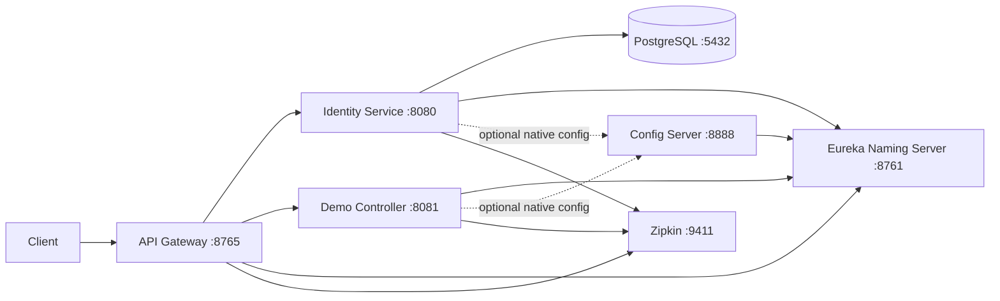
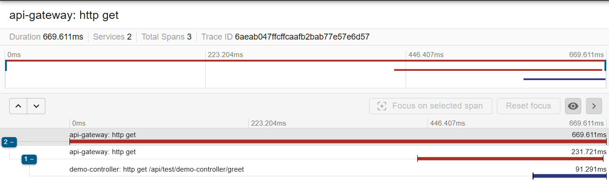

# Spring Boot Microservices

[](https://github.com/Pratham-131/Spring-Boot-Microservices-/actions/workflows/ci.yml)

**Tech stack:** Java 17, Spring Boot 3.2.4, Spring Cloud 2023.0.1, Maven, Spring Security, JJWT 0.12.5, Spring Data JPA, PostgreSQL 16, H2 (tests), Eureka, Spring Cloud Config, Spring Cloud Gateway, Resilience4j, Micrometer Tracing/Brave, Zipkin, Docker Compose, GitHub Actions.

A small, five-service Spring Boot monorepo demonstrating service discovery, centralized native configuration, JWT authentication, gateway routing and protection, resilience, persistence, and distributed tracing. The API Gateway is the only application service published for clients; identity and demo services remain internal to the Compose network.

## Table of contents

- [How a request flows](#how-a-request-flows)
- [Architecture](#architecture)
- [Services](#services)
- [Quick start](#quick-start)
- [Environment variables](#environment-variables)
- [API walkthrough](#api-walkthrough)
- [Fault tolerance](#fault-tolerance)
- [Observability](#observability)
- [Design decisions](#design-decisions)
- [Known limitations](#known-limitations)
- [CI/CD](#cicd)
- [Debugging notes](#debugging-notes)
- [Acknowledgements](#acknowledgements)
- [Author and license](#author-and-license)

## How a request flows

1. A client calls the API Gateway on port `8765`.
2. The gateway allows registration and authentication without a token. Other routed requests require a valid, unexpired HS256 JWT signed with `SECRET_KEY`.
3. Eureka-based load balancing selects the identity or demo service, and the gateway strips the first path segment before forwarding.
4. Identity verifies credentials, issues JWTs, and stores issued tokens in PostgreSQL so logout can mark a token revoked. The demo endpoint itself does not validate JWTs; gateway protection is the boundary.
5. Resilience4j circuit breakers and fallbacks handle downstream errors, while Micrometer Tracing reports gateway, identity, and demo spans to Zipkin.

## Architecture



The Config Server serves native configuration from its classpath `config` directory. Eureka and Config Server expose health endpoints but do not include tracing dependencies.

## Services

| Service | Port | Role | Key tech |
|---|---:|---|---|
| `eureka-naming-server` | 8761 | Service registry | Eureka Server, Actuator |
| `spring-cloud-config-server` | 8888 | Native configuration and service discovery client | Spring Cloud Config Server, Eureka Client, Actuator |
| `identity-service` | 8080 (internal) | Registration, authentication, token tracking | Spring Security, JJWT, JPA, PostgreSQL, Brave |
| `demo-controller-microservice` (`demo-controller`) | 8081 (internal) | Protected-by-gateway greeting endpoint | Spring MVC, Eureka Client, Brave |
| `api-gateway-service` | 8765 | Client entry point, JWT validation, routing and resilience | Spring Cloud Gateway, Eureka, LoadBalancer, Resilience4j, JJWT, Brave |

## Quick start

### Prerequisites

- Java 17 (for local runs and tests; the Maven wrapper is included)
- Docker Engine with Docker Compose v2 (for the full stack)

### Create the `.env` file

Create a local `.env` file at the repository root. It is gitignored and must not be committed. `SECRET_KEY` must be a Base64 string of at least 32 random bytes.

**macOS / Linux / Git Bash:**

```bash
printf 'SECRET_KEY=%s\n' "$(openssl rand -base64 32)" > .env
```

**Windows PowerShell:**

```powershell
$key = [Convert]::ToBase64String((1..32 | ForEach-Object { Get-Random -Maximum 256 }))
Set-Content .env "SECRET_KEY=$key"
```

A template is available as `.env.example`.

### Option A: Docker Compose

From the repository root:

```bash
docker compose up --build
```

The application services wait for their required dependencies to become healthy. Config Server waits for Eureka; identity waits for PostgreSQL, Eureka, Config Server, and started Zipkin; demo waits for Eureka, Config Server, and started Zipkin; gateway waits for Eureka, Config Server, healthy identity and demo, and started Zipkin.

| Compose service | Container name | Host port |
|---|---|---:|
| `postgres` | `postgres` | 5432 |
| `adminer` | `adminer` | 8090 |
| `zipkin` | `zipkin` | 9411 |
| `eureka-naming-server` | `eureka-naming-server` | 8761 |
| `spring-cloud-config-server` | `spring-cloud-config-server` | 8888 |
| `identity-service` | `identity-service` | Internal only |
| `demo-controller-microservice` | `demo-controller` | Internal only |
| `api-gateway-service` | `api-gateway-service` | 8765 |

Stop the stack with `docker compose down`. The named PostgreSQL volume remains unless explicitly removed.

The first build can be slow because five Maven builds download dependencies in parallel. After startup, allow about a minute for Eureka registration and the gateway's LoadBalancer cache before the first request; early calls may return the `503` fallback.

### Option B: Run services locally

Start PostgreSQL and Zipkin using the Compose definitions:

```bash
docker compose up -d postgres zipkin
```

In separate terminals, start services in this order:

```bash
cd eureka-naming-server && ./mvnw spring-boot:run
cd spring-cloud-config-server && ./mvnw spring-boot:run
cd identity-service && ./mvnw spring-boot:run
cd demo-controller-microservice && ./mvnw spring-boot:run
cd api-gateway-service && ./mvnw spring-boot:run
```

On Windows Command Prompt or PowerShell, use `mvnw.cmd spring-boot:run` from each service directory instead. Identity and demo use the optional Config Server import; all services register with Eureka. The gateway does not import Config Server.

### Run the tests

```bash
cd identity-service && ./mvnw -B clean verify
```

Repeat in each service directory. Identity tests run against H2 with security filters enabled.

## Environment variables

| Variable | Used by | Default / purpose |
|---|---|---|
| `SECRET_KEY` | Identity, gateway, demo (Compose) | Required Base64-encoded key; at least 32 decoded bytes for HS256. Stored in the local root `.env`. |
| `DB_HOST` | Identity | `localhost` locally; `postgres` in Compose. |
| `DB_PORT` | Identity | `5432` |
| `DB_NAME` | Identity and PostgreSQL | `identitydb` |
| `DB_USER` | Identity and PostgreSQL | `postgres` |
| `DB_PASSWORD` | Identity and PostgreSQL | `postgres` |
| `EUREKA_CLIENT_SERVICEURL_DEFAULTZONE` | Config, identity, demo, gateway | `http://localhost:8761/eureka/` locally; Compose sets the Eureka container URL. |
| `SPRING_CONFIG_IMPORT` | Identity and demo | Optional Config Server import; defaults to `optional:configserver:http://localhost:8888`. |
| `ZIPKIN_ENDPOINT` | Identity, demo, gateway | `http://localhost:9411/api/v2/spans`; Compose points to `zipkin`. |

## API walkthrough

All client requests use the gateway at `http://localhost:8765`. The gateway strips `/identity-service` or `/demo-controller` before forwarding.

| Method | Gateway path | Access | Result |
|---|---|---|---|
| `POST` | `/identity-service/api/auth/register` | Public | `{"token":"<JWT>"}` |
| `POST` | `/identity-service/api/auth/authenticate` | Public | `{"token":"<JWT>"}` |
| `POST` | `/identity-service/api/auth/logout` | Bearer JWT | Marks the presented token revoked; returns `204 No Content` |
| `GET` | `/demo-controller/api/test/demo-controller/greet` | Bearer JWT | `Hello from secure endpoint` |

Register requires `firstname`, `lastname`, `email`, and `password`. Errors return JSON:

- Duplicate email: `409` with `{"error":"Email already registered"}`
- Missing or invalid fields: `400` with `{"error":"<message>"}`

Register, authenticate, then call the greeting endpoint with and without a token:

```bash
API=http://localhost:8765

curl -sS -X POST "$API/identity-service/api/auth/register" \
  -H 'Content-Type: application/json' \
  -d '{"firstname":"Ada","lastname":"Lovelace","email":"ada@example.com","password":"correct-horse-battery"}' \
  | jq

TOKEN=$(curl -sS -X POST "$API/identity-service/api/auth/authenticate" \
  -H 'Content-Type: application/json' \
  -d '{"email":"ada@example.com","password":"correct-horse-battery"}' \
  | jq -r '.token')

curl -i "$API/demo-controller/api/test/demo-controller/greet" \
  -H "Authorization: Bearer $TOKEN"
# HTTP 200; response body: Hello from secure endpoint

curl -i "$API/demo-controller/api/test/demo-controller/greet"
# HTTP 401 Unauthorized
```

On Windows PowerShell, use `curl.exe` (not the `curl` alias) and escape JSON quotes, for example `-d '{\"email\":\"ada@example.com\",\"password\":\"correct-horse-battery\"}'`.

## Fault tolerance

Both gateway routes use circuit breakers with a 10-call sliding window, a 50% failure threshold, a 10-second open-state wait, and three half-open probes. The minimum number of calls is 10. Each route also has a 4-second time limiter. Identity calls use `identityCB`; greeting calls use `demoCB`. Fallback endpoints return HTTP `503` and a JSON `error` message.

To exercise the demo fallback, first authenticate and set `TOKEN` as above, then:

```bash
docker stop demo-controller
curl -i "$API/demo-controller/api/test/demo-controller/greet" \
  -H "Authorization: Bearer $TOKEN"
# HTTP 503 {"error":"Demo Controller unavailable. Try later."}
docker start demo-controller
```

The identity fallback can be exercised the same way: stop `identity-service`, then post to the logout route with a valid token. Expect `503` with `{"error":"Identity Service unavailable. Try later."}`. A stopped service may not immediately be considered unavailable because of Eureka and LoadBalancer caching; allow roughly a minute for discovery state to catch up. The breaker transitions through **closed** (requests pass), **open** (calls fail fast to fallback), and **half-open** (limited probes test recovery).

## Observability

- Zipkin UI: [http://localhost:9411](http://localhost:9411)
- Identity, demo, and gateway sample every trace (`management.tracing.sampling.probability=1.0`) and include `traceId` and `spanId` in log levels.
- Eureka and Config Server have no tracing dependencies.
- Actuator health is exposed by all Spring services at `/actuator/health`.

A single request through the gateway produces one trace across services. This trace shows the gateway server span, the gateway client call, and the demo-controller span:



Docker healthchecks also produce `/actuator/health` traces. In Zipkin, filter by `spanName` (for example `http get /api/test/demo-controller/greet`) to hide them.

## Design decisions

| Decision | Why | Trade-off |
|---|---|---|
| Gateway is the only client-facing application service | Centralizes routing and JWT enforcement | Direct access to internal service ports is not provided by Compose |
| JWTs use a Base64 HS256 key shared through environment configuration | Keeps validation consistent between identity and gateway | Key rotation is manual and requires coordinated deployment |
| Config Server uses native classpath configuration | Makes the sample self-contained without an external Git repository | Configuration changes require rebuilding/restarting the Config Server |
| Identity persists issued tokens for logout revocation tracking | Supports recording logout against a specific token | The gateway does not consult the token store |
| PostgreSQL is used at runtime and H2 for tests | Matches production-like persistence while keeping tests self-contained | H2 does not reproduce every PostgreSQL behavior |
| One project and Maven wrapper per service | Services can be built and verified independently | Shared Maven configuration is repeated across service projects |
| Brave tracing is enabled for gateway, identity, and demo | Enables cross-service traces in Zipkin | Sampling every request adds overhead |

## Known limitations

- The gateway validates JWT signature and expiry but does not check the identity service's revoked-token records.
- There is no token refresh endpoint.
- Secrets are supplied through environment variables and a local, ignored `.env` file.
- Compose runs a single instance of each service; horizontal scaling and production deployment configuration are out of scope.
- There is no rate limiting.
- The demo service does not validate JWTs itself; the gateway is the security boundary.
- Eureka/LoadBalancer caching can delay recovery and fallback behavior. After restarting a downstream service, expect `503` for up to about a minute.
- Applications wait for Zipkin to start, not to become healthy, so the earliest spans after a cold start can be dropped.

## CI/CD

GitHub Actions runs on pushes and pull requests targeting `main`. A matrix job uses Temurin Java 17 and runs `./mvnw -B clean verify` independently in each of the five service directories. The workflow verifies builds and tests; it does not build or publish Docker images.

## Debugging notes

- **Cold-start timeout hid a real bug.** The first register through the gateway hit the 4s circuit-breaker timeout and returned the 503 fallback, but identity had already created the user. The retry returned an empty 401: the duplicate-email exception was forwarded to `/error`, which was not permitted. **Fix:** permit `/error`, return 409 JSON on duplicate email and 400 JSON on invalid input, and add MockMvc tests with security filters enabled.
- **Zipkin start race.** Gateway and demo logged "zipkin:9411 failed to respond" at startup, so the earliest spans were dropped. Zipkin became healthy afterwards and later requests trace normally. Listed under Known limitations; gating startup on the Zipkin healthcheck would remove it.
- **Slow first Docker build.** Five parallel Maven builds downloaded dependencies at roughly 30-60 kB/s and looked stuck, but were working. Later builds are fast thanks to Docker layer caching.
- **Docker VM could not reach Maven Central.** On one network the build failed with "Connection refused" while the host could connect. Workaround: build the jar on the host and `COPY` it into the image. The committed Dockerfiles keep the multi-stage build so CI and fresh clones work.

## Acknowledgements

Structure and README layout inspired by [AlexPeti/spring-boot-microservices](https://github.com/AlexPeti/spring-boot-microservices) (MIT). The code was rebuilt independently.

## Author and license

Author: [Pratham-131](https://github.com/Pratham-131) | License: MIT